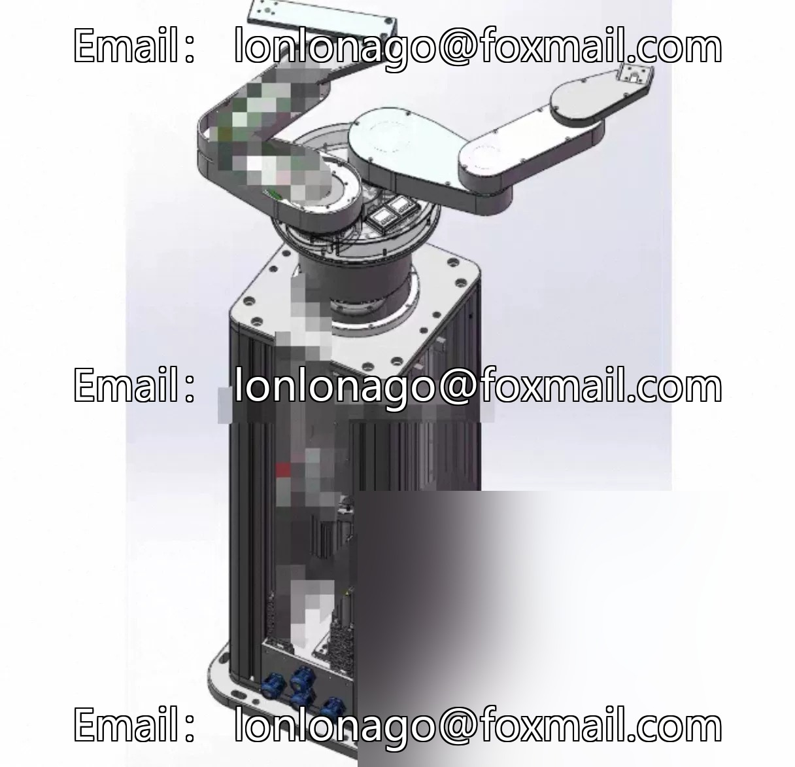
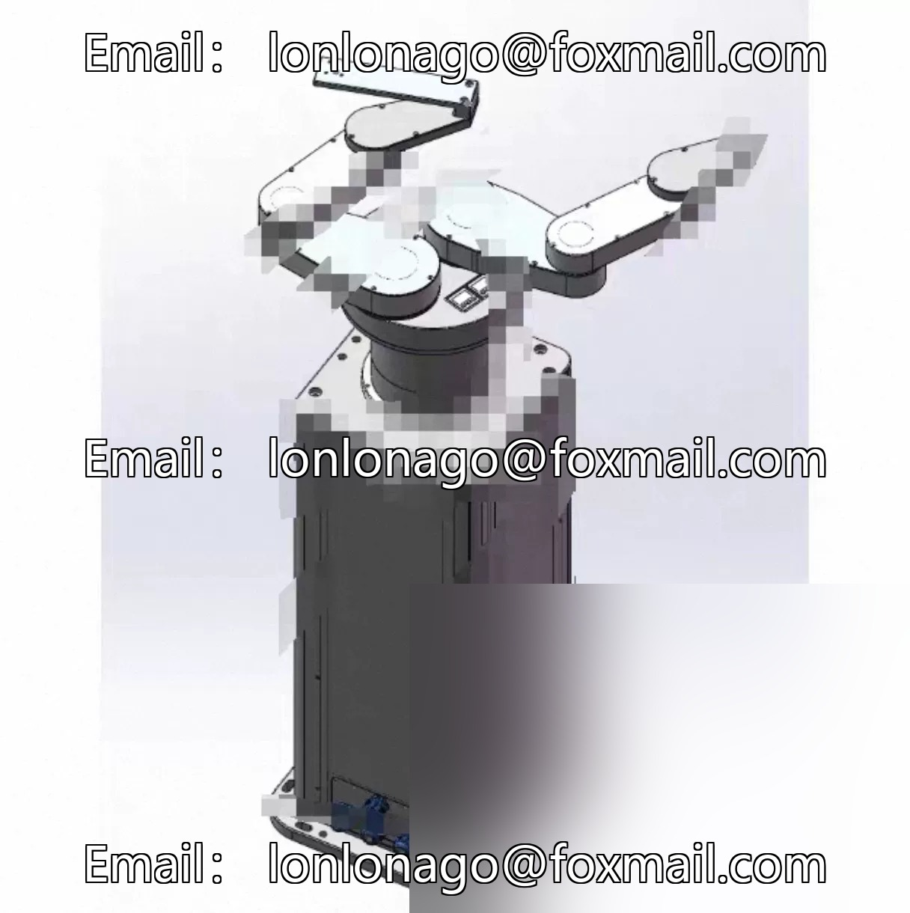
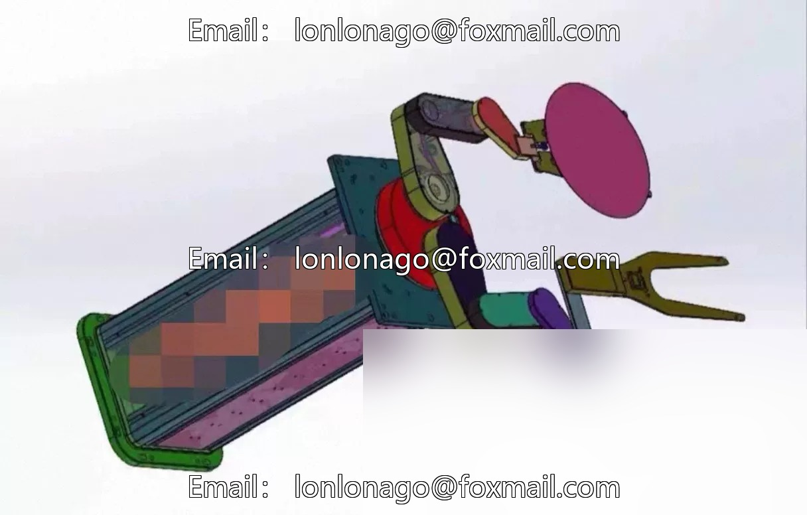

# Wafer mechanical arm 3D drawing

## Body

3D drawings of wafer mechanical arms: latest model! Detailed 3D drawings, with a double arm structure featuring an overhead structure. Belt double-press tightening design! Both arms use dust-free synchronous belts with synchronous driving to complete synchronous stretching, rotating, lifting, and moving functions.
Download the file! are non-refundable upon sale!

A 3D drawing of the semiconductor wafer handling robot is provided, covering a two-arm structure, lifting structure and a belt double top tightening design.

<!-- AI_ENRICHED -->

## Images

## Payment

Here is a pay link on Stripe ( https://buy.stripe.com/3cs8yP7sY87d0vu9AB ). Please contact me lonlonago@foxmail.com after funding $89, and I will send you a complete data files , thank you!

